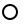
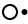

# AI Use Levels 1.2

"I used AI for this" has stopped meaning anything. The same sentence covers a chatbot that polished one paragraph and an agent that ran all night with access to production. AI Use Levels is a tag of 4 words in a fixed order, Level · Hand · Door · Tool. It says in one breath what one piece of work owes to generative AI: whether the tool could change anything by itself, how much of the result is its output, whether what it did can be taken back, and what the tool was. SAE J3016 rates a car once, when it's built; a use tag rates one trip. It describes what happened on one piece of work, and what the tool was capable of doesn't change it.

The canonical page is https://papers.4thcltr.com/ai-use-levels/. The machine-readable form is `spec.json` in this repository, with its JSON Schema beside it in `spec.schema.json`, and the licence is CC BY 4.0.

## 1. Identity

| Field | Value |
|---|---|
| Name | AI Use Levels. A tag is called a *use tag*, and a piece of work can be called "a level-two use" |
| Version | 1.2. The scheme has versions, but a use tag has no date (section 9) |
| Purpose | To say in one breath what one piece of work owes to generative AI, so 2 people can tell whether they're talking about the same kind of use |
| Principle | The same tool is `L1` on Monday and `L3` on Tuesday, and both tags are true |
| What it is not | A permission system, an audit or a liability column. It records whether a person had the chance to intervene. How well they used that chance isn't part of it |
| The 3 questions | Could it change anything by itself, and did each change wait for a yes? How much of the result is its output? Could it be undone? |

## 2. Syntax

The human form is the canonical one. Write the slots in a fixed order, with any separator people already type:

```
L2 · made · undo · Claude Code
```

Said aloud, it's "level two, made, undo, Claude Code". As a sentence, it's "Claude Code made it under supervision, all under undo."

| Slot | Values | Required |
|---|---|---|
| Level | `L0` `L1` `L2` `L3`, or the level's name | always |
| Hand | `touched` `drafted` `made` | recommended |
| Door | `undo` `no undo` | at L2 and L3; left out at L0 and L1, where there's nothing to undo |
| Flag | `unread` | only when true |
| Tool | free text, last; optional reach in parentheses: `(chat)` `(IDE)` `(app)` `(API)` `(agent)` | at L1 and above |

The shortest honest tag with a tool in it is `L1 · ChatGPT`. The full tag is Level · Hand · Door · Flag · Tool. That's 5 slots, and the tag is still 4 words, because the flag is a state and is shown only when it's true.

The machine form goes in a commit trailer, front matter, an HTML meta or an image sidecar. It uses the same tokens and puts the tool in parentheses:

```
AI-Use: L2 made undo (Claude Code)
```

The pattern is `AI-Use: <level> [hand] [door] [flag] [(<tool>)] [v<major>]`.

`AI-Use: L0` is the whole L0 tag, and the human form is `L0`. It has no Hand, Door, flag or Tool, because no tool touched the work. An L0 tag is a person's claim about their own work.

Every token identifies itself. An `L` and a digit is a Level, a Hand word is a Hand, a Door word is a Door, `unread` is the flag, and parentheses hold the tool. A parser recognizes each token by its spelling and doesn't rely on where it stands. The tool runs from the first opening parenthesis to the last closing one, so a reach parenthetical can nest inside it, as in `AI-Use: L1 touched (Copilot (IDE))`. A tag with no version token is version 1. A tag written under a later version puts its own version token after the tool, such as `v2`. The trailer goes next to git's `Co-Authored-By`; that one names the tool, and this one says what the tool was allowed to do.

Absence. No tag means nothing is claimed. It never means L0.

## 3. LEVEL (the headline)

The question is whether the tool could change anything by itself, and whether each change waited for a yes. A change is an effect outside the conversation: it wrote, sent, paid, deployed, deleted, published or told someone. Reading, searching and generating text aren't changes.

| Level | Name | Definition | Test |
|---|---|---|---|
| `L0` | None | No AI touched it | None |
| `L1` | Suggested | It could change nothing by itself. A person moved every piece of its output into the work (pasted, typed, accepted, pressed send) | Did anything take effect except by a person's own action? No |
| `L2` | Supervised | It made changes itself, and each change waited for a person's yes before it took effect | Could a person have stopped every change before it counted? Yes |
| `L3` | Unattended | It made changes itself without waiting for anyone | Did anything take effect before a person could stop it? Yes |

The flag `unread` means no accountable person has read the result, and it can go with any level. `L1 · made · unread · DeepL` is a translation posted blind. `L3 · made · no undo · unread · (tool)` is the bot that merged to production. The flag comes off once a person reads the result, which makes it a state that ends; a level never changes after the fact.

Rules:

- Give each piece of work one tag. Where the steps differed, tag the highest level reached by any step that changed something. A read-only step doesn't raise the level.
- The person decides how fine-grained the yeses are. One yes to a plan of 40 changes is L2, because the person could have said no before anything happened, and 400 yeses in 2 hours is still L2. The tag rates the opportunity to intervene. A rubber stamp is still tagged L2, since the scheme can't tell diligence from its absence.
- A yes comes after the plan exists and covers the change. A standing instruction, such as "merge and deploy without asking", was given before there was anything to say yes to, so it isn't a yes, and changes made under one are L3.
- A person here means someone accountable for the work, so a model reviewing a model doesn't lower the level.
- A tag is a person's statement. A tool may draft one, and the person accountable for the work confirms or corrects it before it goes on anything. [docs/for-agents.md](docs/for-agents.md) says what an agent can report about its own session and what it has to leave to the person.
- A run that changed nothing outside the conversation is L1, however long it ran. A research agent that worked for 20 minutes and produced a report is `L1 · made`.
- The numbers don't map to SAE J3016. In SAE, L3 is the handover level. Here, L3 means only that the tool acted without waiting.

## 4. HAND (its hand in the result)

Hand says how much of the final is the machine's output. It rates who produced the result and leaves the ideas out of it. A transcript, a translation and a summary are all `made`, and the reader knows from the genre whose ideas they were. Hand doesn't depend on Level, so a person can press every button and still publish something the machine made whole. That's `L1 · made`, and it's the case most often left untagged.

| Token | Definition | Test |
|---|---|---|
| `touched` | Corrections and local changes to a person's material: polish, autocomplete, spot fixes, formatting | Would a reader recognize anything of its output in the final? Barely |
| `drafted` | It produced a first version a person substantially reworked | Its shape survives; most of the words or code are a person's |
| `made` | The final is substantially its output; a person chose, read, maybe trimmed | Its words, code or pixels survive |

Rules:

- Judge the final result. The number of interactions doesn't matter, and 200 tab-accepts that add up to most of the file are `made`.
- Choosing one isn't reworking it. One picked from 40 generations is `made`, and inpainting a hand doesn't change that.
- If you're unsure between 2 rungs, pick the larger.
- Hand has 3 rungs because a single label can't say enough. Meta's single "Made with AI" label landed on retouched photos and was renamed within months.

## 5. DOOR (what it did that cannot be taken back)

Door is tagged only at `L2` and `L3`, because at `L1` the machine changed nothing. It rates whether the machine's changes can be reversed, and who they reached counts too.

| Token | Definition | Test |
|---|---|---|
| `undo` | Everything it changed can be reversed by the tagger alone, asking nobody: a branch, a versioned document, a trash can, a staging system nobody else saw | Could you put it all back in minutes without telling anyone? Yes |
| `no undo` | At least one change cannot be taken back: sent, paid, deployed, deleted without backup, published, told someone. Reaching a person or system you do not control always counts, even if a rollback exists, because they saw it | Did anything leave your control? Yes |

Rules:

- Tag the least reversible change, even if every other change could be put back. One sent email makes the whole piece `no undo`.
- Door rates only the machine's changes. If the AI drafted an email and a person reworked it and pressed send, the send is the person's act, so the tag is `L1 · drafted` with no Door. The person owns that irreversibility, and the tag shows it by leaving the slot empty.

## 6. TOOL (free text, last)

Name the tool as specifically as you can: `Claude Opus 5.5`, `Claude Code`, `Copilot (IDE)`, `GPT-5 (API)`. A product name is acceptable, but a model version is better because it fixes the date. How the tool was reached goes here as an optional parenthetical: `(chat)`, `(IDE)`, `(app)`, `(API)`, `(agent)`. Reach is a property of the tool, and Level and Door already cover its risk, so it doesn't get a slot of its own.

With several tools, name the one with the biggest hand first and add the others after a plus: `L2 · made · undo · Claude Code + Copilot`.

## 7. Worked examples

Each tag follows from the tests in sections 3 to 5. `(tool)` stands for whichever tool it was.

| Use | Tag |
|---|---|
| I wrote it with no AI at all | `L0` |
| A chatbot polished one paragraph | `L1 · touched · ChatGPT` |
| Autocomplete suggested a few lines | `L1 · touched · Copilot (IDE)` |
| I asked for the whole post and posted it as-is | `L1 · made · ChatGPT` |
| Grammarly fixed typos as I typed | `L1 · touched · Grammarly` |
| I picked 1 of 40 generated images and didn't edit it | `L1 · made · Midjourney` |
| A research agent ran for 20 minutes and changed nothing, and I used its report | `L1 · made · Deep Research` |
| I posted a machine translation in a language I can't read | `L1 · made · unread · DeepL` |
| A coding agent asked permission for every edit, and I read each diff | `L2 · made · undo · Claude Code` |
| An agent proposed an infrastructure plan, I approved it once, and the apply made 40 changes | `L2 · made · no undo · (tool)` |
| An agent ran overnight on a branch and opened a pull request, which I then read | `L3 · made · undo · Claude Code` |
| A lint-fixer ran unattended on a branch, and I read its changes before merging | `L3 · touched · undo · (tool)` |
| An agent with production and email access ran unattended, and I read the logs afterwards | `L3 · made · no undo · (tool)` |
| An agent ran under a standing instruction to merge and deploy, and I read the result afterwards | `L3 · made · no undo · (tool)` |
| A bot auto-merged on green CI, and nobody has read the diff | `L3 · made · no undo · unread · (tool)` |
| A meeting bot emailed its summary to every attendee before the host saw it | `L3 · made · no undo · unread · (tool)` |
| AI drafted the email, and I reworked it and pressed send | `L1 · drafted · Claude` |

The same examples are in `examples/examples.json` with their machine form, and a test checks that the two lists match.

## 8. Marks

A mark is a symbol for the Level alone. It's for places with no room for the full tag, such as a social bio, an image overlay, a chat display name or a slide footer. The circle stands for the work and the dot for the tool. The 4 marks differ only in where the dot is, so they can be read without colour or letters, in any language.

| Level | Mark | Where the dot is | Name | Spoken |
|---|---|---|---|---|
| `L0` None |  | no dot | AI USE LEVEL ZERO SYMBOL | "AI use level zero, None" |
| `L1` Suggested |  | outside the circle, because the tool never touched the work and a person brought its output in | AI USE LEVEL ONE SYMBOL | "AI use level one, Suggested" |
| `L2` Supervised |  | on the circle's edge, because each change stopped at the edge for a yes | AI USE LEVEL TWO SYMBOL | "AI use level two, Supervised" |
| `L3` Unattended |  | inside the circle, because the tool changed the work by itself | AI USE LEVEL THREE SYMBOL | "AI use level three, Unattended" |

1. A mark shows the Level and nothing else. Hand, Door, the flag and the Tool are left to the full tag. A mark takes no `no undo` or other modifier, because the set of 4 marks is fixed (rule 10.7).
2. A mark points to a full tag. Put the full tag in the mark's link, alt text or title, or next to the work. A mark with no full tag behind it claims nothing, the same as a missing tag (section 2).
3. Alt text and the SVG `<title>` are the label `AI use level 2, Supervised`. A screen reader says it as the spoken form "AI use level two, Supervised" and doesn't describe the shape.
4. The marks are monochrome and must stay distinct at 12 px and at 1 bit. Don't add letters, digits or colour inside the circle.
5. The files are in `marks/`, black on white (`-light`) and white on black (`-dark`), under CC0 so anyone can redraw or embed them. `spec.json` lists each mark with its name, spoken form, file names and braille.
6. Braille is Unified English Braille, uncontracted, stored as Unicode braille cells. `braille` spells the level token as typed in a tag: `L0` ⠠⠇⠼⠚, `L1` ⠠⠇⠼⠁, `L2` ⠠⠇⠼⠃, `L3` ⠠⠇⠼⠉ (capital letter indicator, l, numeric indicator, digit). `brailleName` spells the level name: None ⠠⠝⠕⠝⠑, Suggested ⠠⠎⠥⠛⠛⠑⠎⠞⠑⠙, Supervised ⠠⠎⠥⠏⠑⠗⠧⠊⠎⠑⠙, Unattended ⠠⠥⠝⠁⠞⠞⠑⠝⠙⠑⠙. A tactile label puts the token, the name or both beside the raised mark, token first and then the name, with a space between them. Tool names stay off tactile labels; the label points to the machine form, as rule 2 asks of every mark. A braille reader hasn't checked these strings yet, and `spec.json` says so under `marksStatus`.

Examples:

| Where | Mark | Full tag behind it |
|---|---|---|
| A blog post byline, linked | L1 mark | `L1 · drafted · Claude Opus 5.5` |
| A slide footer | L2 mark | `L2 · made · undo · Claude Code` in the speaker notes and the deck's sources slide |
| An overlay on a generated image | L1 mark | `L1 · made · Midjourney` in the image's alt text and sidecar |
| A support bot's display name | L3 mark | the dated standing tag on the help page: `L3 · made · no undo · (tool)`, since June 2026 |

The robot-face mark proposed for 1.1 (`🤖2`) is withdrawn. It's no shorter than `L2`, an emoji looks different on each platform, and a screen reader reads it as "robot face".

## 9. Dated or versioned?

Version the scheme and date a standing tag, but leave a use tag undated.

1. The scheme is versioned as 1.0, 1.1 and so on, like CC 4.0. A tag with no version token is version 1.
2. A use tag on one piece of work has no date, because the post, commit, document or release it belongs to already has one. Tokens never change meaning (section 10), so an old tag reads correctly forever. A hand-typed tag also has to stay short.
3. Give the tool's version where it has one, and write `Claude Opus 5.5` where you'd otherwise write `Claude`. The model name tells a reader roughly when the work was done.
4. A standing tag on a system or a policy is dated. "Support bot runs at `L3 · made · no undo · (tool)`, 2% read, since June 2026." "Production changes are L2 or lower (policy of 2026-10)." Stances get revised, and a reader needs to know which one was in force. The standing tag is also the form for a fleet, so 10,000 chats share one dated standing tag. Its machine form is the same `AI-Use:` line as any tag, and the date goes beside it, in the same place the human form puts it. There's no date token, and none is added.
5. An artifact with no date of its own, such as a bio, an evergreen page or a screenshot that will be reposted, gets a date beside the tag.

Some object that the same agent suggests today and executes unattended tomorrow. The principle in section 1 answers that without any date, because the tag describes one piece of work.

## 10. Extension rules

1. A published token never changes meaning. A bad token is fixed by adding a new token and deprecating the old one. Nothing gets redefined or renumbered.
2. Levels grow upward only. The first candidate for `L4` is *it chose the task*. Every current level assumes a person set the goal, so a proactive agent that decides what to do next would need a new rung; a flag wouldn't be enough.
3. A new slot has its own closed vocabulary, and no word is shared between slots, so every token still identifies itself and order stays a reading convention. New slots go before the tool.
4. A minor version adds tokens, flags or slots, or settles a rule the scheme left open, and stays backward compatible. A tag written before 1.2 keeps its meaning. A major version is a last resort. Deprecate tokens and never remove them.
5. These are candidates for a later minor version (1.3 or after), left out to keep the tag at 4 words: `checked` (tests, a fact-check or a second reader ran; it answers whether the person could even read it), `data` (the material left your machine, or went to training), `whose` (my things, our things, other people's things), and duration.
6. Governance. The specification is public and anyone can fork it, and it keeps a changelog. Proposals are made as issues. A token is accepted when 3 real uses can't be tagged honestly without it.
7. A mark (section 8) isn't a token, so the 3-uses test in rule 6 doesn't apply to it. The mark set is fixed for every 1.x version. A new mark is added only with a new level, and a published mark never changes its level.

## 11. Known limits

- It rates the opportunity to intervene. A rubber stamp at `L2` gets the same tag as a real review.
- Hand is self-reported and will be shaded downward. CRediT had the same problem and spread only when publishers required it.
- It says nothing about what the tool was *permitted* to do. That's a governance question (the Cloud Security Alliance framework, Zheng et al.), and its answer belongs in a dated standing tag.
- It doesn't establish liability. It does show where liability needs an owner, which is every piece of work tagged L3 with `no undo`.

## 12. Route to a standard

I want the 4 marks encoded in Unicode, as the Creative Commons symbols were. 🅭 and 🅯 entered Unicode 13.0 in 2020, years after the licences were in wide use. The Unicode Technical Committee (UTC) encodes a symbol when there's evidence that people other than its authors use it in running text. This is the order of work:

1. Publish the marks. The SVGs are in this repository under CC0. A small open font could map them to Private Use Area code points until real ones exist, and nobody has taken that on yet.
2. Use them on the 4th Culture sites and in the README of each gorfednet repository whose commits carry the `AI-Use` trailer.
3. Keep a public log of third-party use, with links and dates, opened as issues in this repository.
4. When the log shows use by unrelated publishers, submit a UTC proposal for 4 characters with the names in section 8, the spoken forms, the reference glyphs and the log as evidence.

Alongside that:

- Machine form. Register `AI-Use` as an HTML meta name on the WHATWG MetaExtensions list, and propose the tag to IPTC as a value set beside its digital source type, which C2PA manifests already reference.
- Commit trailer. `AI-Use` follows git's trailer syntax and needs no registration. Tools that read `Co-Authored-By` are asked to read it too.

I haven't submitted anything to any body yet. Each submission will be listed here with its date once it's made.

## 13. Prior art

| Scheme | What it rates | Relation |
|---|---|---|
| Sheridan & Verplank 1978; Parasuraman, Sheridan & Wickens 2000 (10 levels of automation) | Who decides and who is told | The lineage. `L1` to `L3` compress their "executes with veto / executes and informs / does not inform" |
| SAE J3016 L0 to L5 | The vehicle, fixed at manufacture | The analogy. This scheme rates the trip and doesn't share its numbers |
| Human in / on / out of the loop (DoD 3000.09, autonomous-weapons policy) | Oversight position | The same idea as L1 to L3. I dropped the words because "on the loop" is jargon and sounds like "in the loop" when said aloud |
| AI Assessment Scale, Perkins / Furze / Roe / MacVaugh (5 levels) | What a student is permitted to use | It rates permission, and this scheme rates disclosure; it has no agents acting on the world |
| Feng, McDonald & Zhang 2025, operator to observer | The user's role in an agent system | Rates the configuration; the closest in spirit |
| Mitchell et al. 2025 (Hugging Face), autonomy levels | Agent systems | Argues against the top rung; rates the system |
| Morris et al. 2023, Levels of AGI (DeepMind) | System capability and autonomy | Rates the system |
| Cloud Security Alliance, Agentic AI Autonomy Levels v2 (2026) | Enterprise deployments, 5 dimensions, prescribed controls | Governance. The standing tag of section 9 is a small version of it |
| Zheng et al. 2026, capability vs permission | Separates could from may | Adopted, because a use tag is about did |
| CRediT | Human authorship roles | Hand is a 3-rung CRediT for machines |
| IPTC digital source type, C2PA | Machine-readable provenance of media | The machine-readable Hand for images. A use tag can go beside it |
| Creative Commons | Licence terms | The syntax model: few self-identifying tokens, versioned, a human layer and a machine layer. CC Signals (2025) is about training and is a separate thing |
| Bezos's "one-way and two-way doors" | Decision reversibility | Door is that idiom applied to the machine's changes |
| "Loop engineering", "four levels of agentic loops" | Agent architecture | Only a name collision, and the reason I dropped the working title "Loop Levels" |

Sources read:

- https://arxiv.org/abs/2403.14692v2
- https://leonfurze.com/2023/12/18/the-ai-assessment-scale-version-1/
- https://labs.cloudsecurityalliance.org/research/agentic-ai-autonomy-levels-control-framework-v2-csa-styled/
- https://www.alphaxiv.org/abs/2607.23438
- https://medium.com/@tahirbalarabe2/what-is-loop-engineering-four-levels-of-agentic-loops-ccc48b850002
